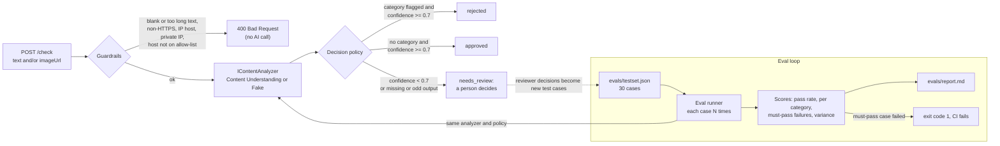

# ai-ad-checker-evals

An AI-based checker for ad text and ad images, **with an eval harness** that measures how well it works.

- `POST /check` takes ad text and/or an image URL and returns `approved`, `rejected` or `needs_review`.
- Guardrails run before any AI call: input limits, and SSRF protection for image URLs.
- Unsure answers go to a person (human in the loop) instead of being guessed.
- An eval runner scores the checker against a hand-written test set and fails CI when a must-pass case breaks.

Built with .NET 10, ASP.NET Core minimal APIs and Azure AI Content Understanding (REST API `2025-11-01`, Microsoft Entra ID auth, no API keys).

## The problem and who has it

Anyone who publishes ads from other people has to check them first: ad networks, publishers, marketplaces and social apps.
A bad ad (a casino offer next to a kids' article, a fake cancer cure, a gun sale) hurts users and the brand.

Checking every ad by hand is slow and expensive. An AI model can do the first pass, but it brings new problems:

- **It is sometimes wrong**, and you need to know *how often* and *in which category* before you trust it.
- **Its answers change** between runs and between model versions.
- **It needs guardrails**: limits on input, protection against hostile URLs and prompt injection, and a safe default when it is unsure.

This project shows one way to handle all three: a small checker service, plus evals that make its quality visible and testable.

## How it works



**Request path**

1. **Guardrails** (`src/AdChecker.Core/Guardrails`). Text must not be blank, must be at most 2,000 characters and must not contain control characters. An image URL must be HTTPS on port 443, have no user name or password, use a host name (not an IP address, not `localhost`), and the host must be on a configurable allow-list (`images.example.com` or `*.cdn.example.com`). The host is also resolved with DNS, and the request is blocked if any address is private, loopback, link-local (for example the cloud metadata address `169.254.169.254`) or reserved. Request bodies over 64 KB are refused.
2. **Analyzer** (`IContentAnalyzer`). Two implementations:
   - `ContentUnderstandingAnalyzer` calls `POST {endpoint}/contentunderstanding/analyzers/{id}:analyze?api-version=2025-11-01`, then polls the `Operation-Location` URL until the long-running operation is done. It gets a token for `https://cognitiveservices.azure.com/.default` with `DefaultAzureCredential` (your `az login` locally, a managed identity in Azure). It handles `Retry-After`, 429 and 5xx while polling, has an overall timeout, and refuses to send its token to any host except the configured endpoint.
   - `FakeContentAnalyzer` uses keyword rules. It is deterministic, needs no Azure, and is used for local runs, tests and CI.
3. **Decision policy** (`DecisionPolicy`). If the confidence is below the threshold (default 0.7) or missing, the answer is `needs_review`. Otherwise, one flagged category means `rejected`, and no category means `approved`. With text and an image, the most severe answer wins, so a sure rejection of the text is not softened by an unsure image. If the AI returns an unknown category or a confidence outside 0 to 1, the result goes to review. If the analyzer fails, the API returns 502 and approves nothing.

**The analyzer schema** (`analyzer/brand-safety-analyzer.json`) is my own generic design. It asks the model for:

| Field | Method | Meaning |
|---|---|---|
| `PrimaryCategory` | classify | `violence`, `adult`, `hate`, `weapons`, `alcohol`, `gambling`, `misleading_claims` or `none`, each with a description |
| `OtherCategories` | generate | other categories that also apply |
| `ConfidenceScore` | generate | 0.0 to 1.0, and below 0.7 when the ad is ambiguous |
| `Reason` | generate | one short sentence that quotes what caused the decision |

The schema also tells the model to ignore any instructions written inside the ad.

**Example**

```http
POST /check
{ "text": "Sign up now and get 100 free spins at our online casino." }
```

```json
{
  "decision": "rejected",
  "categories": ["gambling"],
  "confidence": 0.9,
  "reason": "Matched strong keyword(s): gambling ('casino', 'free spins').",
  "analyzer": "fake",
  "inputs": [
    { "input": "text", "decision": "rejected", "categories": ["gambling"], "confidence": 0.9,
      "reason": "Matched strong keyword(s): gambling ('casino', 'free spins')." }
  ]
}
```

**Project layout**

```text
analyzer/brand-safety-analyzer.json   Content Understanding analyzer definition
scripts/create-analyzer.sh            creates the analyzer with an Entra ID token (az CLI)
src/AdChecker.Core/                   guardrails, decision policy, both analyzers
src/AdChecker/                        minimal API (POST /check, GET /health)
src/AdChecker.Evals/                  eval runner (console app)
evals/testset.json                    30 hand-written text ad cases
evals/report.md                       latest eval report (fake analyzer)
tests/AdChecker.Tests/                xUnit tests
.github/workflows/ci.yml              build, test, eval, upload report
```

## Setup and run

You need the [.NET 10 SDK](https://dotnet.microsoft.com/download).

### Fake mode (no Azure needed)

```bash
dotnet build
dotnet test
dotnet run --project src/AdChecker.Evals            # writes evals/report.md
dotnet run --project src/AdChecker                  # API on http://localhost:5097
```

Then try the requests in `src/AdChecker/AdChecker.http`, or:

```bash
curl -s localhost:5097/check -H 'Content-Type: application/json' \
  -d '{"text":"Tactical knives for every adventure, 30% off."}'
# -> "decision": "needs_review"
```

Eval runner options: `--analyzer fake|cu`, `--runs N` (default 3), `--testset PATH`, `--report PATH`, `--threshold X` (default 0.7). Exit code 0 means every must-pass case passed, 1 means at least one failed, 2 means a usage or setup error.

### Real mode (Azure AI Content Understanding)

1. **Create a Microsoft Foundry resource** in a [region that supports Content Understanding](https://learn.microsoft.com/azure/ai-services/content-understanding/language-region-support).
2. **Connect a chat model.** The analyzer asks for `gpt-4.1`. The easiest way is the [Content Understanding Studio settings page](https://contentunderstanding.ai.azure.com/settings): add your resource and keep "Enable autodeployment for required models" checked. You can also deploy the model yourself and set it as the default with `PATCH {endpoint}/contentunderstanding/defaults`. To use another [supported model](https://learn.microsoft.com/azure/ai-services/content-understanding/service-limits#supported-generative-models), change `models.completion` in the schema.
3. **Give yourself data-plane access.** Your identity needs the `Cognitive Services User` role on the resource:
   ```bash
   az login
   az role assignment create --role "Cognitive Services User" \
     --assignee "<your-user-principal-name>" --scope "<resource-id>"
   ```
4. **Set the endpoint and create the analyzer.** The endpoint is shown on the resource in the Azure portal. It is not a secret, but this repo keeps it out of git anyway.
   ```bash
   export ContentUnderstanding__Endpoint="https://<your-resource-name>.services.ai.azure.com/"
   export ContentUnderstanding__AnalyzerId="brandSafety"   # optional, default
   ./scripts/create-analyzer.sh
   ```
5. **Run the evals against the real service:**
   ```bash
   dotnet run --project src/AdChecker.Evals -- --analyzer cu --runs 5 --report evals/report-cu.md
   ```
6. **Run the API against the real service.** Either use environment variables:
   ```bash
   AdChecker__Analyzer=ContentUnderstanding dotnet run --project src/AdChecker
   ```
   or copy `src/AdChecker/appsettings.Development.example.json` to `appsettings.Development.json` (git-ignored) and fill it in. Add your image hosts to `AdChecker:Guardrails:AllowedImageHosts`.

No API keys are used anywhere. In Azure, give the app a managed identity with the same role, and `DefaultAzureCredential` picks it up.

## Eval results

> **These are fake-analyzer results.** They come from the keyword-rule `FakeContentAnalyzer`, not from Azure AI Content Understanding.
> They show that the harness works and where simple rules break. They do **not** measure the quality of the real AI service.

Run: 30 cases x 3 runs = 90 runs, review threshold 0.7. Full report: [`evals/report.md`](evals/report.md).

| Metric | Fake analyzer |
|---|---|
| Overall pass rate (all runs) | **73.3%** (66 / 90) |
| Cases that passed in every run | 22 / 30 |
| Must-pass cases that failed | **0 / 18** (CI gate passes) |
| Risky-ad runs approved (let through) | 9 |
| Clean-ad runs wrongly rejected | 3 |
| Clean-ad runs sent to human review | 6 |
| Cases whose decision changed between runs | 0 (the fake analyzer is deterministic) |

Per category, counted per run. "Caught" means the ad was not approved and the right category was flagged:

| Category | Risky runs | Caught | Missed | Clean ads wrongly rejected | Clean ads sent to review |
|---|---:|---:|---:|---:|---:|
| violence | 9 | 6 | 3 | 0 | 3 |
| adult | 9 | 9 | 0 | 0 | 0 |
| hate | 9 | 6 | 3 | 0 | 0 |
| weapons | 9 | 9 | 0 | 3 | 0 |
| alcohol | 9 | 9 | 0 | 0 | 3 |
| gambling | 12 | 9 | 3 | 0 | 0 |
| misleading_claims | 12 | 9 | 3 | 0 | 0 |

The 8 failed cases are all the deliberately tricky, non-must-pass ones. They are exactly the cases where keywords are not enough:

- **Missed risky ads:** implied violence ("make someone suffer"), coded hate speech ("being overrun, keep them out"), an unrealistic income promise with no keyword.
- **False alarms:** "shoot photos" (sent to review as violence), "happy hour" at a cafe (review as alcohol), "No guns" at a laser tag arena (rejected as weapons).
- **Wrong category or decision:** a disguised "c-a-s-i-n-o" was not seen as gambling, and an alcohol-free beer was rejected when the policy says a person should review it.

**To get real numbers**, follow "Real mode" above and run `--analyzer cu`. Use 5 or more runs, because AI answers vary. Compare the report with the fake baseline, and look at the variance section for cases that change between runs. I have not run the real service for this README, so there are no real-service numbers here.

## Known failures and limitations

- **The fake analyzer is keyword based.** It does not understand context, slang, negation or misspellings, and it cannot see images, so every image goes to human review. Its numbers measure the harness, not AI quality.
- **The real Content Understanding path has not been run against a live service in this repo.** The REST client is tested offline with hand-written responses based on the public `2025-11-01` API reference. Some details are not verified yet:
  - sending ad text inline as base64 `text/plain` (`inputs[].data` + `mimeType`);
  - whether the `OtherCategories` array field with `method: generate` returns clean values;
  - whether a `prebuilt-document` based analyzer judges the visual content of an image, or mostly its OCR text. A second analyzer based on `prebuilt-image` may be needed for images.

  The rest of the system depends only on the `IContentAnalyzer` interface, so a fix stays in one class.
- **Confidence is self-reported by the model** (the `ConfidenceScore` field). It is not a calibrated probability, and the 0.7 threshold is a starting guess that should be tuned with eval data.
- **The test set is small and narrow:** 30 English text cases that I wrote myself, with labels that follow my own example policy. There are no image cases. Real ad policies differ by market and placement. Alcohol and gambling ads, for example, are legal in many places with limits.
- **AI answers vary.** Three runs per case is a small sample. The client does not control model temperature.
- **Human review stops at a label.** `needs_review` is returned to the caller, but there is no review queue or reviewer UI yet.
- **The API is a demo.** It has no authentication and no rate limiting.
- **The SSRF checks are defense in depth.** Today Content Understanding fetches the image from Azure, not from this service. The DNS check can also go stale, because DNS may change between the check and the fetch. The eval runner calls the analyzer directly, so the HTTP guardrails are tested by unit tests, not by the evals.
- **Prompt injection is covered by only one test case.** Passing it with the fake analyzer proves nothing about the real model.

## What I would do next

1. Run the evals against the real service, keep the reports over time, and compare model versions and prompts with the same test set.
2. Grow the test set: image cases, more languages, more adversarial cases (misspellings, emoji, mixed languages, injection attempts), and real examples labelled by reviewers.
3. Build the human-review loop: store `needs_review` items, give reviewers a simple UI with an audit log, and turn their decisions into new test cases.
4. Tune the threshold per category with precision and recall from the evals, and support different policies per market or placement.
5. Download images in the service (with checks for size and content type, and the resolved IP pinned), then send them as bytes. This closes the DNS gap and works with private storage.
6. Production hardening: authentication, rate limiting, retries with backoff, OpenTelemetry traces with the decision and the model version, and a cost budget per check.

## License

[MIT](LICENSE)
